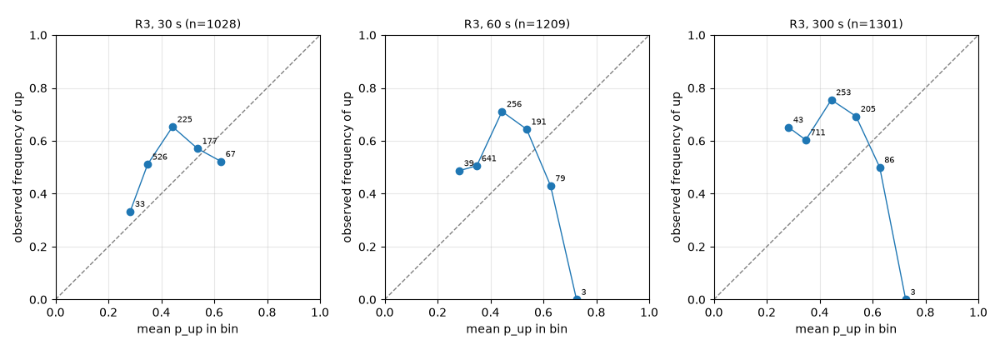
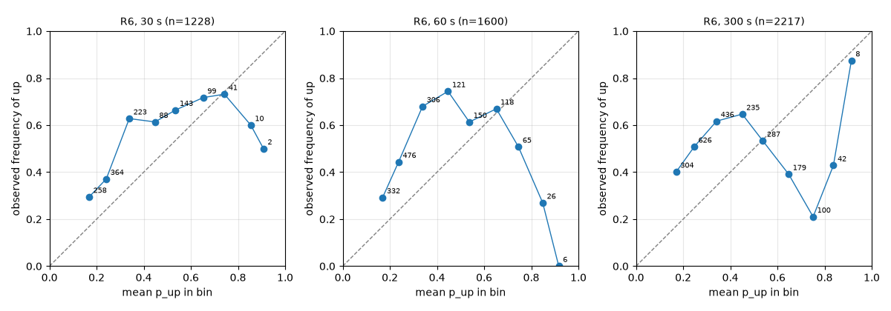
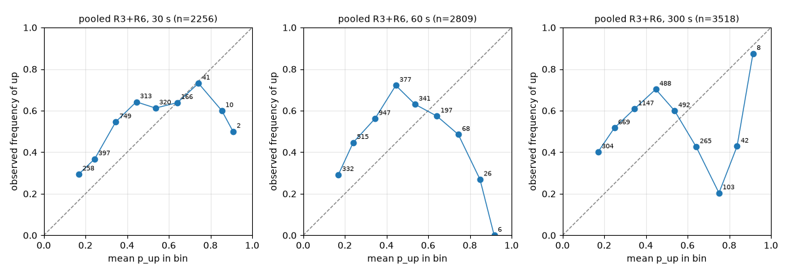

<!-- Generated by scripts/evidence.py from the run databases. Do not edit. -->
# E5 Calibration (real-model runs)

Every decision is scored, traded or not: label 1 if the mid rose over the horizon, 0 if it
fell, ties dropped. Brier and the baseline are computed with `jevhl.calibration`, as on the
dashboard. The baseline is the running base rate: at each decision, the share of up labels
seen so far in that run (0.5 at the start), so it never sees the future. A model with skill
has a lower Brier than the baseline.

Overlap: consecutive decisions share most of their outcome window. In R3 a scored taker decision came every 5.3 s (median), so about 11 decisions fall inside one 60 s window; R6 scored a maker decision every 1.0 s (median; 2.2 s mean, since it scores only changed books). Sample counts below are decisions, not independent samples; the "windows" column (scored time span / horizon) is a rough count of non-overlapping outcome windows. Longer horizons overlap more.

The interval is a moving-block bootstrap (2000 resamples, seed 20261014) of the
per-decision Brier minus baseline, with blocks one horizon long in decisions (horizon /
median gap between scored decisions, rounded up); pooled resamples each run on its own.
"Result" reads the interval: below zero is better than the baseline, above zero worse, across
zero no difference shown. With fewer than 10 blocks (the number in brackets:
decisions / block length) the resamples barely vary and the row says too few samples. The
pooled baseline runs within each run, so pooled Brier minus baseline is the decision-weighted
mean of the two runs.

| Run | Horizon | n scored | Windows | Block length (blocks) | Mean p_up | Up rate | Brier | Baseline | Brier - baseline | 95% block bootstrap | Result |
|---|---|---|---|---|---|---|---|---|---|---|---|
| R3 | 30 s | 1028 | 239 | 6 (171) | 0.417 | 0.548 | 0.2682 | 0.2499 | +0.0183 | [-0.0036, +0.0420] | no difference shown |
| R6 | 30 s | 1228 | 117 | 30 (41) | 0.349 | 0.495 | 0.2505 | 0.2511 | -0.0006 | [-0.0525, +0.0487] | no difference shown |
| pooled R3+R6 | 30 s | 2256 | 356 | 6+30 (212) | 0.380 | 0.519 | 0.2586 | 0.2506 | +0.0080 | [-0.0224, +0.0368] | no difference shown |
| R3 | 60 s | 1209 | 119 | 12 (101) | 0.415 | 0.564 | 0.2737 | 0.2475 | +0.0262 | [-0.0077, +0.0600] | no difference shown |
| R6 | 60 s | 1600 | 58 | 60 (27) | 0.350 | 0.511 | 0.2786 | 0.2508 | +0.0278 | [-0.0441, +0.0934] | no difference shown |
| pooled R3+R6 | 60 s | 2809 | 177 | 12+60 (127) | 0.378 | 0.534 | 0.2765 | 0.2494 | +0.0271 | [-0.0155, +0.0653] | no difference shown |
| R3 | 300 s | 1301 | 23 | 57 (23) | 0.413 | 0.640 | 0.2907 | 0.2310 | +0.0597 | [-0.0629, +0.1533] | no difference shown |
| R6 | 300 s | 2217 | 11 | 300 (7) | 0.383 | 0.510 | 0.3055 | 0.2503 | +0.0552 | [-0.0225, +0.1127] | too few samples |
| pooled R3+R6 | 300 s | 3518 | 34 | 57+300 (30) | 0.394 | 0.558 | 0.3001 | 0.2432 | +0.0569 | [-0.0088, +0.1070] | no difference shown |

Other real-model runs, not part of the plan's calibration set (R2 ended early on the stale-
book stop; R5 lasted 14 minutes), for completeness:

| Run | Horizon | n scored | Windows | Block length (blocks) | Mean p_up | Up rate | Brier | Baseline | Brier - baseline | 95% block bootstrap | Result |
|---|---|---|---|---|---|---|---|---|---|---|---|
| R2 | 30 s | 907 | 245 | 6 (151) | 0.438 | 0.558 | 0.2681 | 0.2477 | +0.0204 | [-0.0122, +0.0534] | no difference shown |
| R5 | 30 s | 186 | 27 | 30 (6) | 0.593 | 0.720 | 0.2070 | 0.2067 | +0.0003 | [-0.0631, +0.1031] | too few samples |
| R2 | 60 s | 1038 | 123 | 12 (86) | 0.436 | 0.587 | 0.2774 | 0.2433 | +0.0341 | [-0.0174, +0.0774] | no difference shown |
| R5 | 60 s | 227 | 13 | 60 (4) | 0.630 | 0.696 | 0.2594 | 0.2185 | +0.0409 | [+0.0056, +0.1375] | too few samples |
| R2 | 300 s | 1283 | 24 | 58 (22) | 0.431 | 0.645 | 0.2886 | 0.2294 | +0.0592 | [-0.0588, +0.1494] | no difference shown |
| R5 | 300 s | 225 | 2 | 225 (1) | 0.624 | 1.000 | 0.1925 | 0.0011 | +0.1913 | [+0.1913, +0.1913] | too few samples |

Read plainly: the model was better than the baseline in: none. Worse in: none (calibration set) and none (other runs). Too few samples to read: R5 30 s, R5 60 s, R6 300 s, R5 300 s. Everywhere else: no difference shown. With these sample sizes (at most 356 non-overlapping windows in
a row) a small real edge could not be seen either way; PROBLEM.md expected a few thousand
decisions to be needed, and the extra run that would have added more (plan item E7) was not
done.

The model leaned down: pooled at 60 s its mean `p_up` was 0.378 while
0.534 of the labels were up (per run in the table). On 2026-10-08, with a
placeholder prompt, the decider had leaned up (PIPELINE.md); E6 tests whether recalibration
removes the lean.

## Reliability (10 equal bins; n = decisions in the bin)

A calibrated model's points sit on the diagonal. Bins with few decisions are noise.

### R3

| p_up bin | n 30 s | mean p 30 s | freq up 30 s | n 60 s | mean p 60 s | freq up 60 s | n 300 s | mean p 300 s | freq up 300 s |
|---|---|---|---|---|---|---|---|---|---|
| 0.0-0.1 | 0 | n/a | n/a | 0 | n/a | n/a | 0 | n/a | n/a |
| 0.1-0.2 | 0 | n/a | n/a | 0 | n/a | n/a | 0 | n/a | n/a |
| 0.2-0.3 | 33 | 0.282 | 0.333 | 39 | 0.282 | 0.487 | 43 | 0.282 | 0.651 |
| 0.3-0.4 | 526 | 0.348 | 0.511 | 641 | 0.348 | 0.505 | 711 | 0.347 | 0.603 |
| 0.4-0.5 | 225 | 0.443 | 0.653 | 256 | 0.444 | 0.711 | 253 | 0.444 | 0.755 |
| 0.5-0.6 | 177 | 0.537 | 0.571 | 191 | 0.537 | 0.644 | 205 | 0.537 | 0.693 |
| 0.6-0.7 | 67 | 0.625 | 0.522 | 79 | 0.627 | 0.430 | 86 | 0.627 | 0.500 |
| 0.7-0.8 | 0 | n/a | n/a | 3 | 0.725 | 0.000 | 3 | 0.725 | 0.000 |
| 0.8-0.9 | 0 | n/a | n/a | 0 | n/a | n/a | 0 | n/a | n/a |
| 0.9-1.0 | 0 | n/a | n/a | 0 | n/a | n/a | 0 | n/a | n/a |
### R6

| p_up bin | n 30 s | mean p 30 s | freq up 30 s | n 60 s | mean p 60 s | freq up 60 s | n 300 s | mean p 300 s | freq up 300 s |
|---|---|---|---|---|---|---|---|---|---|
| 0.0-0.1 | 0 | n/a | n/a | 0 | n/a | n/a | 0 | n/a | n/a |
| 0.1-0.2 | 258 | 0.168 | 0.295 | 332 | 0.169 | 0.292 | 304 | 0.171 | 0.401 |
| 0.2-0.3 | 364 | 0.241 | 0.371 | 476 | 0.237 | 0.443 | 626 | 0.247 | 0.508 |
| 0.3-0.4 | 223 | 0.339 | 0.628 | 306 | 0.339 | 0.680 | 436 | 0.342 | 0.617 |
| 0.4-0.5 | 88 | 0.448 | 0.614 | 121 | 0.447 | 0.744 | 235 | 0.451 | 0.647 |
| 0.5-0.6 | 143 | 0.535 | 0.664 | 150 | 0.537 | 0.613 | 287 | 0.538 | 0.533 |
| 0.6-0.7 | 99 | 0.653 | 0.717 | 118 | 0.652 | 0.669 | 179 | 0.648 | 0.391 |
| 0.7-0.8 | 41 | 0.742 | 0.732 | 65 | 0.745 | 0.508 | 100 | 0.751 | 0.210 |
| 0.8-0.9 | 10 | 0.854 | 0.600 | 26 | 0.849 | 0.269 | 42 | 0.838 | 0.429 |
| 0.9-1.0 | 2 | 0.908 | 0.500 | 6 | 0.917 | 0.000 | 8 | 0.914 | 0.875 |
### pooled R3+R6

| p_up bin | n 30 s | mean p 30 s | freq up 30 s | n 60 s | mean p 60 s | freq up 60 s | n 300 s | mean p 300 s | freq up 300 s |
|---|---|---|---|---|---|---|---|---|---|
| 0.0-0.1 | 0 | n/a | n/a | 0 | n/a | n/a | 0 | n/a | n/a |
| 0.1-0.2 | 258 | 0.168 | 0.295 | 332 | 0.169 | 0.292 | 304 | 0.171 | 0.401 |
| 0.2-0.3 | 397 | 0.244 | 0.368 | 515 | 0.240 | 0.447 | 669 | 0.249 | 0.517 |
| 0.3-0.4 | 749 | 0.346 | 0.546 | 947 | 0.345 | 0.562 | 1147 | 0.345 | 0.609 |
| 0.4-0.5 | 313 | 0.444 | 0.642 | 377 | 0.445 | 0.721 | 488 | 0.447 | 0.703 |
| 0.5-0.6 | 320 | 0.536 | 0.613 | 341 | 0.537 | 0.630 | 492 | 0.538 | 0.600 |
| 0.6-0.7 | 166 | 0.641 | 0.639 | 197 | 0.642 | 0.574 | 265 | 0.641 | 0.426 |
| 0.7-0.8 | 41 | 0.742 | 0.732 | 68 | 0.745 | 0.485 | 103 | 0.751 | 0.204 |
| 0.8-0.9 | 10 | 0.854 | 0.600 | 26 | 0.849 | 0.269 | 42 | 0.838 | 0.429 |
| 0.9-1.0 | 2 | 0.908 | 0.500 | 6 | 0.917 | 0.000 | 8 | 0.914 | 0.875 |
