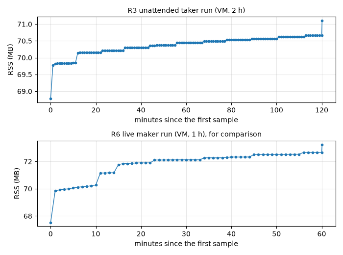

<!-- Generated by scripts/evidence.py from the run databases. Do not edit. -->
# E4 Unattended run (R3)

R3: taker, real model, live testnet, on the VM, 2026-10-10 15:19:24 UTC to
2026-10-10 17:19:27 UTC (2.0 h). It was not an overnight run: the user decided on
2026-10-10 that 2 hours unattended was enough for now.

| Measure | R3 |
|---|---|
| Decisions | 1365 |
| Hold rate | 64.9% (not stuck at 0% or 100%) |
| Late-hold rate | 0.00% |
| RSS samples | 122 (at start, once a minute, at the end) |
| RSS at start / 1 min / last in-run / at shutdown | 68.8 / 69.8 / 70.7 / 71.1 MB |
| RSS mean by quarter of the run | 70.0 / 70.3 / 70.5 / 70.6 MB |
| RSS growth, 1 min to last in-run sample | +0.88 MB (+0.45 MB an hour) |
| Error, kill, stale or flatten events | 0 |
| Websocket reconnects | 10 (server-side "Expired" closes) |
| Orders skipped by the bot's own 2-a-minute limit | 424 |

MB here is 1000 kB, as in the run reports. Memory was still rising in the last quarter of the run (quarter means above), so it had not levelled off by the end; a run this short cannot tell a slow leak of this size from warm-up. At this rate a 10-hour run would add about 4 MB.

The process stopped cleanly on Ctrl-C at the end (exit 130); that is from the PIPELINE.md log,
since the database cannot record its own exit.

For comparison, R6 (maker, 1 h, not an unattended-run test) went from 69.8 MB
at 1 minute to 72.7 MB before shutdown (+2.82 MB, +2.87 MB
an hour), a faster rise than R3's.
